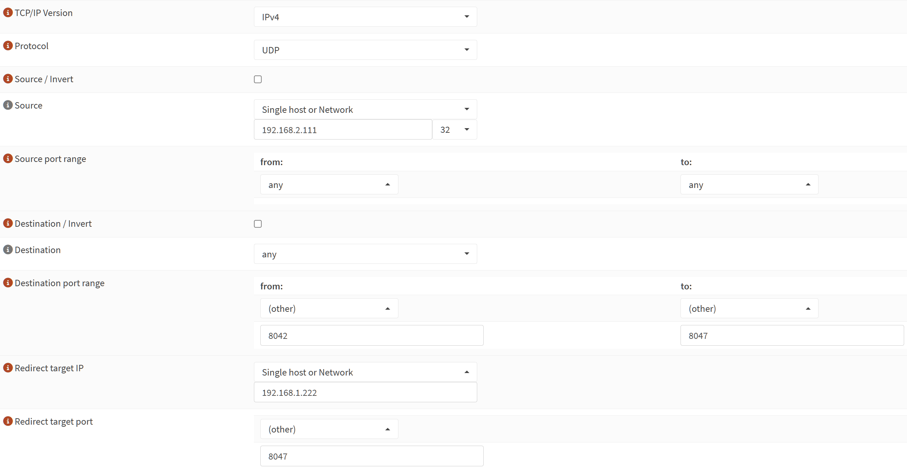
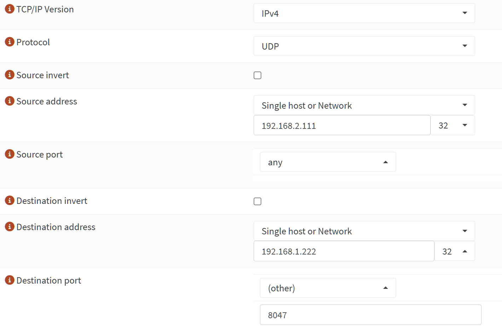

# JuicePassProxy Documentation

This app runs [JuicePassProxy](https://github.com/JuiceRescue/juicepassproxy) to intercept UDP traffic from a JuiceBox EV charger and publish entities to Home Assistant via MQTT auto-discovery.

## Choosing a Traffic Redirection Mode

To start, read [the JuicePassProxy README](https://github.com/JuiceRescue/juicepassproxy) to learn more about the three modes of operation:

1. **Router NAT Redirection (Recommended):** Redirects outbound UDP traffic from your JuiceBox to Home Assistant at the router/firewall level.
2. **Local DNS Spoofing (Recommended):** Overrides DNS resolution on your local DNS server so the JuiceBox sends UDP telemetry to Home Assistant.
3. **UDPC Mode (Last Resort):** Uses telnet (`update_udpc: true`) to continually point the JuiceBox at Home Assistant. Only use this if you cannot configure DNS spoofing or NAT, as it is significantly less reliable.

### Recommended Settings for DNS Spoofing or NAT

* **Ignore EnelX (`ignore_enelx`):** `true`
* **Update UDPC (`update_udpc`):** `false`
* **EnelX IP (`enelx_ip`):** `127.0.0.1`
* **JuiceBox ID (`juicebox_id`):** The serial number of your JuiceBox.
  * If you do not know the serial number, telnet into your JuiceBox on port `2000` and run `get email.name_address` to retrieve it.
  * *Tip:* Enable **"Show unused optional configuration options"** on the Configuration tab if optional fields are hidden.

## MQTT Configuration

Regardless of which redirection mode you choose, configure the MQTT connection settings (`mqtt_host`, `mqtt_port`, `mqtt_username`, `mqtt_password`) so JuicePassProxy can publish discovery and state messages to your MQTT broker (such as the Mosquitto broker app).

## Setting Up NAT Redirection

The example below uses `192.168.2.111` as the JuiceBox IP and `192.168.1.222` as the Home Assistant IP. Replace both with your actual network addresses.

### OPNSense

1. Go to **Firewall > NAT > Destination NAT** and create a new rule. Set **Interface** to the network interface your JuiceBox is connected to, and configure the remaining options as shown:

   

2. Go to **Firewall > NAT > Source NAT** and create a new rule. Set **Interface** to the network interface your JuiceBox is connected to, and configure the remaining options as shown:

   

3. Apply the firewall changes.
